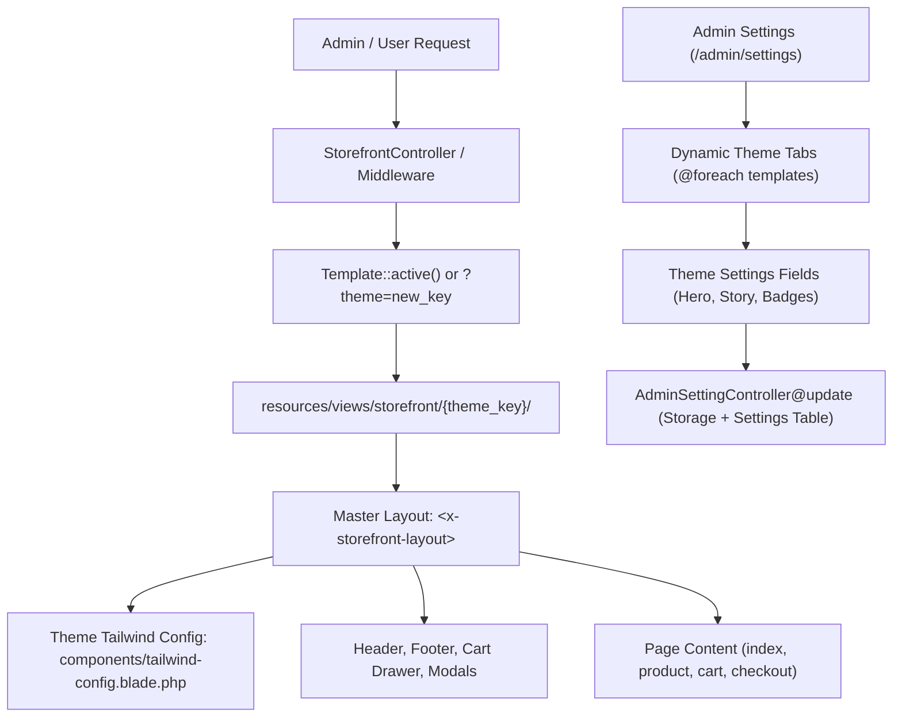

# How to Add a New Designed Theme & Integrate it into Admin Settings

This guide provides a comprehensive, step-by-step walkthrough for designing, registering, and integrating a new storefront theme into the **Nex-on** platform, including adding customization controls to the **Admin Settings** page.

---

## Architecture Overview

Nex-on uses a database-driven, multi-theme architecture powered by Laravel Blade and Tailwind CSS. The storefront dynamically resolves layout templates based on the active record in the `templates` database table, without altering database records, inventory, or cart business logic.



---

## Step-by-Step Implementation Guide

### Step 1: Register the Theme in the Database

Every storefront theme requires an entry in the `templates` database table.

#### 1. Update `database/seeders/TemplateSeeder.php`
Open `database/seeders/TemplateSeeder.php` and append your new theme definition to the `$themes` array:

```php
[
    'key'       => 'aurora',                    // Unique slug: lowercase, no spaces (matches folder name)
    'name'      => 'Aurora',                   // Display brand name shown in Admin
    'is_active' => false,                      // Keep false until ready to activate
],
```

#### 2. Seed or Insert into Database
Run the seeder or execute via Artisan Tinker:

```bash
php artisan db:seed --class=TemplateSeeder
```

Or insert immediately via Tinker:
```bash
php artisan tinker --execute="App\Models\Template::firstOrCreate(['key' => 'aurora'], ['name' => 'Aurora', 'is_active' => false]); App\Models\Template::clearActiveCache();"
```

> [!NOTE]
> Always call `App\Models\Template::clearActiveCache();` after inserting or updating template records to flush the cached active template.

---

### Step 2: Create the Storefront Blade View Files

Create a new directory inside `resources/views/storefront/` matching your theme key:
```
resources/views/storefront/aurora/
```

#### Folder Structure Blueprint
```
resources/views/storefront/aurora/
├── components/
│   ├── header.blade.php              # Navigation, announcement bar, logo, cart button
│   ├── footer.blade.php              # Footer bio, quick links, newsletter form
│   ├── tab-bar.blade.php             # Mobile bottom sticky navigation bar
│   ├── category-sheet.blade.php      # Mobile slide-up category drawer
│   ├── cart-drawer.blade.php         # Slide-out mini bag / cart drawer
│   ├── login-modal.blade.php         # Quick customer authentication modal
│   ├── search-overlay.blade.php      # Fullscreen AJAX live search flyout
│   └── tailwind-config.blade.php     # Theme color palette, fonts & CSS variables
├── partials/
│   ├── quick-view.blade.php          # Interactive product quick view modal
│   └── product-card.blade.php        # Reusable product grid card (e.g. sale-card, lustre-card)
├── index.blade.php                   # Homepage (Hero, Featured, Categories, Reviews)
├── product.blade.php                 # Single product detail, swatches & add-to-bag
├── category.blade.php                # Category browsing & subcategory filters
├── cart.blade.php                    # Full cart & order summary page
├── checkout.blade.php                # Shipping address & Razorpay/COD checkout
├── account.blade.php                 # Order history, saved addresses & profile
├── wishlist.blade.php                # Customer saved wishlist pieces
├── compare.blade.php                 # Side-by-side product comparison table
├── contact.blade.php                 # Contact form & concierge desk
├── about.blade.php                   # Brand atelier story & craftsmanship pillars
├── search.blade.php                  # Product search results grid
└── order-confirmation.blade.php      # Order success page with print invoice
```

> [!TIP]
> You can quickly scaffold your new theme by copying an existing theme folder (e.g., `cp -r resources/views/storefront/lumiere resources/views/storefront/aurora`) and customizing the styling.

#### Theme Tailwind Configuration (`components/tailwind-config.blade.php`)
Define your theme's custom color palette, fonts, and background:

```html
{{-- resources/views/storefront/aurora/components/tailwind-config.blade.php --}}
<script>
tailwind.config = {
  theme: {
    extend: {
      colors: {
        aurora: {
          50:  '#F0FDF4',
          500: '#22C55E',
          900: '#14532D',
        },
        accent: '#F59E0B',
      },
      fontFamily: {
        display: ['Cinzel', 'serif'],
        body: ['Plus Jakarta Sans', 'sans-serif'],
      },
    }
  }
}
</script>
<style>
  body {
    font-family: 'Plus Jakarta Sans', sans-serif;
    background: #FAFDF9;
    color: #1F2937;
  }
  .font-display { font-family: 'Cinzel', serif; }
</style>
```

#### Page View Structure (`index.blade.php`)
Every page view must be wrapped inside the storefront layout component:

```blade
{{-- resources/views/storefront/aurora/index.blade.php --}}
<x-storefront-layout :theme="$theme" title="Home">

  {{-- 1. Hero Section --}}
  <section class="py-16 bg-aurora-50">
    <div class="max-w-7xl mx-auto px-6">
      <h1 class="font-display text-5xl text-aurora-900">
        {{ \App\Models\Setting::get('aurora_hero_title', 'Luminous Living') }}
      </h1>
      <p class="text-slate-600 mt-4">
        {{ \App\Models\Setting::get('aurora_hero_subtitle', 'Handcrafted sustainable textiles.') }}
      </p>
    </div>
  </section>

  {{-- 2. Scrolling Band --}}
  @include('storefront.common.scrolling-band')

  {{-- 3. Quick View Modal --}}
  @include('storefront.aurora.partials.quick-view')

</x-storefront-layout>
```

---

### Step 3: Register in Admin Theme Switcher

Add a preview card for your new theme on the **Themes** management page (`/admin/themes`).

#### Edit `resources/views/admin/themes.blade.php`
Locate the `$previews` array (around line 182) and add your theme key with its palette colors and typography:

```php
$previews = [
    'saaya'     => ['bg' => '#3D0C11', 'accent' => '#C9A24B', 'label' => 'Maroon · Gold · Ivory',    'font' => 'Cormorant Garamond'],
    'buttercup' => ['bg' => '#2C2C2C', 'accent' => '#F5C518', 'label' => 'Charcoal · Buttercup',    'font' => 'Playfair Display'],
    'vyra'      => ['bg' => '#1A1A2E', 'accent' => '#E94560', 'label' => 'Navy · Crimson · Ivory',   'font' => 'Italiana'],
    'lumiere'   => ['bg' => '#405549', 'accent' => '#D4AF37', 'label' => 'Deep Pine · Gold · Champagne', 'font' => 'IM Fell English'],
    'organic'   => ['bg' => '#699E4B', 'accent' => '#F1B927', 'label' => 'Forest Sage · Sunlit Amber · Botanical Cream', 'font' => 'Nunito'],
    'aurora'    => ['bg' => '#14532D', 'accent' => '#F59E0B', 'label' => 'Emerald · Amber · Mint',   'font' => 'Cinzel'], // <-- Add new theme here
];
```

The theme switcher card will now automatically display:
- Dual-color swatch header strip (`bg` and `accent`)
- Theme title and active badge
- Palette description label and font name
- One-click **Activate Theme** button

---

### Step 4: Add Theme Customization to Admin Settings Page

The Admin Settings page (`/admin/settings`) dynamically loads all themes from the `templates` table:
```blade
@foreach($templates ?? [] as $tmpl)
    <button type="button" @click="activeTab = '{{ $tmpl->key }}'" ...>
        <span>{{ $tmpl->name }}</span>
    </button>
@endforeach
```

Because of this dynamic loop, your new theme **automatically appears as a selectable tab** in the Settings page!

#### Option A: Use the Automatic Generic Card (Zero-Code)
The settings view already includes an automatic fallback loop for any future registered themes:
```blade
@foreach($templates ?? [] as $futureTmpl)
    @if(!in_array($futureTmpl->key, ['vyra', 'buttercup', 'lumiere', 'saaya', 'organic']))
        <div x-show="activeTab === '{{ $futureTmpl->key }}'" class="space-y-6" x-cloak>
            ...
        </div>
    @endif
@endforeach
```
This automatically provides a file upload field for `theme_{key}_hero_image` and banner text customization.

#### Option B: Add a Dedicated, Custom Settings Tab Panel (Recommended)
To give your theme bespoke hero image controls, custom badge text, story pillars, and sliders:

##### 1. Whitelist Theme Image Uploads in `AdminSettingController.php`
Open `app/Http/Controllers/Admin/AdminSettingController.php` and add your image keys to `$allowedImageKeys` and `$request->validate()`:

```php
$allowedImageKeys = [
    // ... existing keys
    'aurora_hero_image',
    'aurora_story_image',
];

$request->validate([
    // ... existing rules
    'aurora_hero_image'  => 'nullable|file|mimes:jpeg,png,jpg,gif,svg,webp|max:10240',
    'aurora_story_image' => 'nullable|file|mimes:jpeg,png,jpg,gif,svg,webp|max:10240',
]);
```

##### 2. Add the Settings Tab Panel in `resources/views/admin/settings/index.blade.php`
Under the **Homepage Hero Banners & Visuals** section, add your theme's Alpine container:

```blade
<!-- AURORA THEME SETTINGS -->
<div x-show="activeTab === 'aurora'" class="space-y-8" x-cloak>
    <div class="grid lg:grid-cols-2 gap-8 items-start">
        {{-- Left Column: Hero Image Preview & Upload --}}
        <div class="space-y-4">
            <label class="block text-xs font-semibold text-slate-700 uppercase tracking-wider">Aurora Hero Graphic</label>
            @php $auroraImg = $settings['aurora_hero_image'] ?? ''; @endphp
            <div class="p-4 rounded-xl border border-slate-200 bg-slate-50 flex flex-col items-center gap-3">
                @if(!empty($auroraImg))
                    <div class="relative w-full aspect-[4/5] max-w-[260px] rounded-xl overflow-hidden shadow-md">
                        
                    </div>
                    <label class="inline-flex items-center gap-1.5 text-xs text-rose-600 cursor-pointer">
                        <input type="checkbox" name="remove_aurora_hero_image" value="1" class="rounded">
                        Remove image
                    </label>
                @endif
                <input type="file" name="aurora_hero_image" accept="image/*" class="text-xs text-slate-500">
            </div>
        </div>

        {{-- Right Column: Headline, Badge & Subtitle Texts --}}
        <div class="space-y-4">
            <div>
                <label class="block text-xs font-semibold text-slate-700 uppercase mb-1">Hero Kicker Badge</label>
                <input type="text" name="aurora_hero_badge" 
                       value="{{ $settings['aurora_hero_badge'] ?? 'Artisanal Luxury' }}" 
                       class="w-full px-4 py-2 rounded-xl border border-slate-200 text-xs">
            </div>
            <div>
                <label class="block text-xs font-semibold text-slate-700 uppercase mb-1">Hero Headline</label>
                <input type="text" name="aurora_hero_title" 
                       value="{{ $settings['aurora_hero_title'] ?? 'Luminous Silk Textiles' }}" 
                       class="w-full px-4 py-2 rounded-xl border border-slate-200 text-xs">
            </div>
            <div>
                <label class="block text-xs font-semibold text-slate-700 uppercase mb-1">Hero Subtitle</label>
                <textarea name="aurora_hero_subtitle" rows="3" 
                          class="w-full px-4 py-2 rounded-xl border border-slate-200 text-xs">{{ $settings['aurora_hero_subtitle'] ?? 'Hand-woven luxury comfort.' }}</textarea>
            </div>
        </div>
    </div>
</div>
```

> [!IMPORTANT]
> Any text input field included inside the form is **automatically persisted** to the `settings` database table by `AdminSettingController@update` without needing any database schema changes!

##### 3. Display Settings in Storefront Views
Retrieve the saved settings in your theme views with fallback defaults:

```blade
@php
  $heroImg   = \App\Models\Setting::get('aurora_hero_image');
  $heroBadge = \App\Models\Setting::get('aurora_hero_badge', 'Artisanal Luxury');
  $heroTitle = \App\Models\Setting::get('aurora_hero_title', 'Luminous Silk Textiles');
  $heroSub   = \App\Models\Setting::get('aurora_hero_subtitle', 'Hand-woven luxury comfort.');
@endphp
```

---

### Step 5: Testing & Previewing

#### 1. Live Preview During Development
You do **not** need to switch the active theme live to test it! Simply pass `?theme={key}` in your browser URL:
```
http://localhost/public/Nexon/public/?theme=aurora
```
This forces `StorefrontController` to render your new theme for the current request without affecting real customers.

#### 2. Clear View Cache
Always clear compiled blade views after adding or renaming templates:
```bash
php artisan view:clear
```

#### 3. Run Automated Theme Tests
Run the test suite to ensure all universal routes, components, and policy settings render properly:
```bash
php artisan test --filter=Theme
```

#### 4. Switch Theme Live
Navigate to **Admin Dashboard &rarr; Themes** (`/admin/themes`) and click **Activate Theme** on your new theme card.

---

## Developer Checklist

- [ ] Theme registered in `TemplateSeeder.php` with unique `key` and `name`.
- [ ] Database record inserted via seeder or tinker, and `Template::clearActiveCache()` invoked.
- [ ] Folder created at `resources/views/storefront/{theme_key}/`.
- [ ] All 8 components implemented in `components/` (`header`, `footer`, `tab-bar`, `category-sheet`, `cart-drawer`, `login-modal`, `search-overlay`, `tailwind-config`).
- [ ] All 12 pages implemented (`index`, `product`, `category`, `cart`, `checkout`, `account`, `wishlist`, `compare`, `contact`, `about`, `search`, `order-confirmation`).
- [ ] Swatch preview metadata registered in `resources/views/admin/themes.blade.php`.
- [ ] Image file upload keys whitelisted in `AdminSettingController.php`.
- [ ] Settings tab fields configured in `resources/views/admin/settings/index.blade.php`.
- [ ] Live preview verified via `?theme={theme_key}`.
- [ ] Automated theme tests passed (`php artisan test --filter=Theme`).

