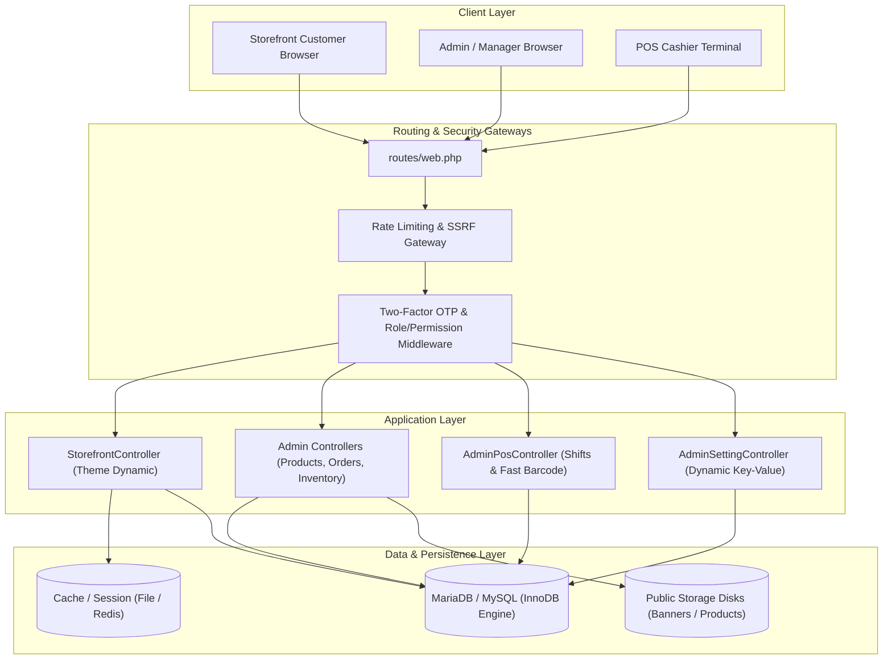
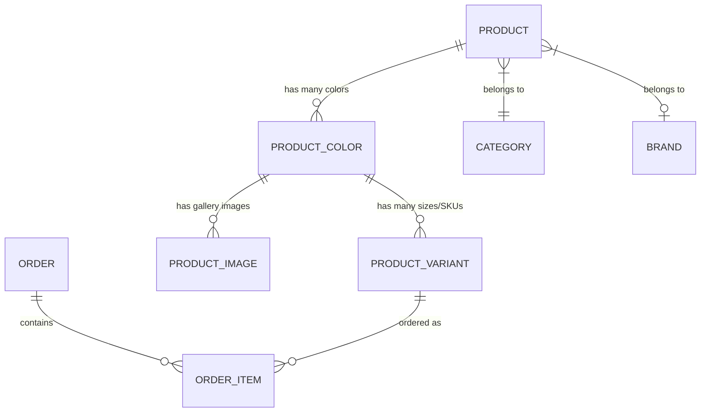

# Nex-on: Architecture, Developer & Operations Guide

> **Authoritative Technical Manual for Engineering & Operations Teams**  
> **Platform Version:** Nex-on Enterprise Multi-Theme E-Commerce & ERP  
> **Framework:** Laravel 10/11 · PHP 8.2+ · MariaDB 10.4+ · Tailwind CSS · Alpine.js

---

## Table of Contents
1. [Architecture Overview](#1-architecture-overview)
2. [Directory Structure & Module Boundaries](#2-directory-structure--module-boundaries)
3. [Storefront Multi-Theme Engine](#3-storefront-multi-theme-engine)
4. [Data Layer, Models & Variant Matrix](#4-data-layer-models--variant-matrix)
5. [Authentication, 2FA OTP & RBAC](#5-authentication-2fa-otp--rbac)
6. [Inventory, Batch Tracking & POS Engine](#6-inventory-batch-tracking--pos-engine)
7. [Security Domains (1 to 11) Implementation](#7-security-domains-1-to-11-implementation)
8. [Settings & Webhooks Management](#8-settings--webhooks-management)
9. [Operations Runbook & Maintenance](#9-operations-runbook--maintenance)
10. [Code Commenting & Style Standards](#10-code-commenting--style-standards)

---

## 1. Architecture Overview

Nex-on is an omnichannel enterprise commerce engine built on Laravel. It combines a zero-downtime, database-driven **5-theme lifestyle storefront** with a modular **Admin ERP back-office**, Point of Sale (POS), inventory batch management, human resource management (HRM), and financial invoicing.



---

## 2. Directory Structure & Module Boundaries

```
c:\xampp\htdocs\public\Nexon/
├── app/
│   ├── Http/
│   │   ├── Controllers/
│   │   │   ├── Admin/               # Back-office ERP controllers (Products, Inventory, POS, etc.)
│   │   │   ├── Auth/                # TwoFactorAuthenticatedSessionController & Login
│   │   │   └── StorefrontController.php # Core public storefront controller
│   │   └── Middleware/              # Permission checks, OTP verification, security headers
│   ├── Models/                      # Eloquent models (Product, Order, Setting, Template, User)
│   ├── Notifications/               # TwoFactorOtpNotification (dispatches secure mail)
│   └── Services/                    # Specialized services (SsrfProtection, HtmlSanitizer, Barcode)
├── database/
│   ├── migrations/                  # 52 structured database migrations
│   └── seeders/                     # Initial database state (Admin, Roles, Themes, Categories)
├── resources/
│   └── views/
│       ├── admin/                   # Admin ERP blade templates
│       ├── components/              # Shared components (storefront-layout, alert, modal)
│       └── storefront/              # 5 Theme views (vyra, buttercup, saaya, lumiere, organic)
│           ├── vyra/                # Modern noir & streetwear aesthetic
│           ├── buttercup/           # Pastel comfort intimates aesthetic
│           ├── saaya/               # Royal Indian trousseau & heritage silk aesthetic
│           ├── lumiere/             # Minimalist French pure silk atelier aesthetic
│           └── organic/             # Verdia botanical luxury aesthetic
├── routes/
│   ├── web.php                      # All storefront, admin, and ERP routes
│   └── auth.php                     # Authentication & Two-Factor OTP routes
└── docs/                            # Architectural guides, checklists, and manuals
```

---

## 3. Storefront Multi-Theme Engine

### Theme Resolution Lifecycle
1. The incoming request hits `StorefrontController`.
2. The active template is fetched via `Template::active()`:
   - Cached in memory for 1 hour (`Cache::remember('active_template', 3600, ...)`).
   - If `?theme={key}` is present in the request query string (e.g. for development or admin preview), that specific theme key is rendered instead of modifying the live database state.
3. Views resolve strictly by convention:
   ```php
   return view("storefront.{$theme->key}.{$page}", $data);
   ```
4. Every theme view extends the master layout `<x-storefront-layout :theme="$theme" title="...">`.
5. The master layout dynamically includes:
   - `@includeIf("storefront.{$theme->key}.components.tailwind-config")` (injects custom color palette and font definitions into the Tailwind runtime)
   - `@includeIf("storefront.{$theme->key}.components.theme-css")` (theme-specific stylesheet overrides)
   - `@include("storefront.{$theme->key}.components.header")`
   - `@include("storefront.{$theme->key}.components.footer")`
   - `@include("storefront.{$theme->key}.components.tab-bar")` (mobile bottom navigation)
   - Floating components: `cart-drawer`, `category-sheet`, `login-modal`, `search-overlay`.

---

## 4. Data Layer, Models & Variant Matrix

### Product & Variant Architecture
Nex-on handles complex fashion / apparel SKU matrices with two layers:
1. **`Product`**: Top-level identity (Title, Description, Category, Brand, Base Price).
2. **`ProductColor`**: Visual variation (Color name, Color hex code, Cover image, Gallery images array).
3. **`ProductVariant`**: Sellable SKU (Color ID, Size [S, M, L, XL, etc.], Price, Compare-At Price, Stock Count, Variant SKU).



### Eliminating N+1 Queries
`StorefrontController` uses eager loading for all product collections:
```php
Product::with(['category.parent.parent.parent', 'brand', 'colors.images', 'colors.variants'])
    ->where('is_active', true);
```
Every card view calls `$product->toCardArray()` to produce a clean, serializable JSON payload consumed by Alpine.js quick-view modals and client-side swatch switchers.

---

## 5. Authentication, 2FA OTP & RBAC

### Security Roles & Seeded Accounts
| Role | Default Email | Default Password | Primary Permissions / Scope |
| :--- | :--- | :--- | :--- |
| **Super Admin** | `admin@nexon.app` | `admin123` | Full unrestricted access across all ERP modules, settings, SMS, roles, and financial reports. |
| **Store Manager** | `manager@nexon.app` | `manager123` | Operates daily store sales, POS checkout, orders, product management, and stock updates. Blocked from system settings, API keys, and role administration with HTTP 403. |
| **Customer / Patron** | Self-registered | Customer password | Storefront purchasing, wishlist, address book, personal order tracking. |

### Two-Factor Email OTP Flow
1. User enters email and password at `/login`.
2. Password validated via bcrypt.
3. System generates a cryptographically secure 4-digit code (`random_int(1000, 9999)`).
4. Code is hashed and saved in session with a 10-minute expiration timestamp.
5. `TwoFactorOtpNotification` dispatches the code via configured SMTP/mail transport.
6. User is redirected to `/verify-otp` (rate-limited to 5 attempts per minute).
7. Upon successful validation, the authenticated session is established.

---

## 6. Inventory, Batch Tracking & POS Engine

### Inventory Rules & POS Sync
* **Atomic Decrements**: When an order is placed (storefront or POS), stock is decremented atomically inside a database transaction (`DB::transaction(...)`) to prevent race conditions.
* **Batch Tracking (FIFO)**: Inbound inventory batches track batch numbers, supplier invoice references, manufacturing dates, and expiration dates.
* **POS Register Shifts**: Cashiers open shifts with a float balance (`opening_cash`), record cash/UPI/card tender types, and reconcile against expected totals upon closing the shift.

---

## 7. Security Domains (1 to 11) Implementation

Nex-on implements rigorous defense-in-depth across 11 security domains:

1. **SQL Injection (SQLi)**: 100% prepared PDO statements via Eloquent ORM. No raw query concatenation.
2. **Cross-Site Scripting (XSS)**: Automatic Blade `{{ }}` entity encoding. Rich HTML descriptions sanitized via `HtmlSanitizerService`.
3. **Cross-Site Request Forgery (CSRF)**: `@csrf` tokens enforced on all state-altering POST/PUT/PATCH/DELETE requests.
4. **Broken Object Level Authorization (BOLA/IDOR)**: Customer addresses, orders, and wishlist items scoped strictly to `Auth::id()`.
5. **File Upload Security**: Strict MIME type validation (`image/jpeg`, `image/png`, `image/webp`), max size boundaries, sanitized SVG parsing, and storage outside web root.
6. **Server-Side Request Forgery (SSRF)**: `SsrfProtectionService` intercepts and blocks webhook / external URLs targeting private IPv4 (RFC 1918), IPv6 loopbacks, or cloud metadata endpoints (`169.254.169.254`).
7. **Rate Limiting & Anti-Brute Force**: Login, OTP verification, coupon redemption, and pincode checking endpoints protected by Laravel `RateLimiter`.
8. **Secure Password Hashing**: Passwords hashed using Bcrypt with cost factor 12.
9. **Two-Factor Authentication (2FA)**: Mandatory numeric OTP challenge with session expiry and resend cooldown.
10. **Role-Based Access Control (RBAC)**: Server-side route middleware `permission:products.*`, `permission:orders.*` blocks unauthorized access regardless of URL tampering.
11. **Security Headers**: Production middleware dispatches `X-Frame-Options: SAMEORIGIN`, `X-Content-Type-Options: nosniff`, `X-XSS-Protection`, and `Referrer-Policy`.

---

## 8. Settings & Webhooks Management

### Key-Value Store (`settings` table)
* **Access**: Use `\App\Models\Setting::get('key', 'default')`.
* **Caching**: Cached automatically with 1-hour TTL in production and 10-second TTL in local environment.
* **Controller**: `AdminSettingController@update` dynamically persists any submitted text input matching the form keys into the `settings` table without requiring database migrations.
* **Image Whitelist**: To prevent arbitrary uploads, image fields are whitelisted in `$allowedImageKeys` in `AdminSettingController.php`.

---

## 9. Operations Runbook & Maintenance

### 1. Starting the Application Environment (Windows / XAMPP)
```powershell
# 1. Start MySQL daemon (port 3306)
Start-Process -FilePath "C:\xampp\mysql\bin\mysqld.exe" -ArgumentList "--defaults-file=C:\xampp\mysql\bin\my.ini" -WindowStyle Hidden

# 2. Verify port listening
netstat -ano | findstr :3306

# 3. Access Storefront
# Open browser to: http://localhost/public/Nexon/public/
```

### 2. Routine Maintenance Commands
```bash
# Clear all application caches
php artisan optimize:clear

# Clear compiled Blade views
php artisan view:clear

# Clear config and route caches
php artisan config:clear
php artisan route:clear

# Run database migrations safely
php artisan migrate --force

# Seed themes or initial data
php artisan db:seed --class=TemplateSeeder
```

### 3. Running Automated Tests
```bash
# Run all theme feature tests
php artisan test --filter=Theme

# Run complete test suite
php artisan test
```

### 4. Troubleshooting Checklist
* **Site stuck loading**: Check whether `mysqld.exe` is running on port 3306. If stopped, launch it via PowerShell `Start-Process`.
* **Theme changes not appearing**: Run `php artisan view:clear` to purge compiled blade templates.
* **Uploaded images not displaying**: Ensure the symbolic storage link exists: `php artisan storage:link`.

---

## 10. Code Commenting & Style Standards

All new contributions must adhere to these standards:

### PHP Class & Method DocBlocks (PSR-5 / PSR-12)
```php
/**
 * Processes payment webhook callback from gateway.
 *
 * @param  \Illuminate\Http\Request  $request  Gateway webhook payload.
 * @return \Illuminate\Http\JsonResponse
 *
 * @throws \InvalidArgumentException If signature verification fails.
 */
public function handleWebhook(Request $request): JsonResponse
{
    // ...
}
```

### Blade Section Markers
```blade
{{-- ===== 1. HERO BANNER SECTION ===== --}}
<section class="...">
  {{-- Content --}}
</section>

{{-- ===== 2. PRODUCT CAROUSEL TRACK ===== --}}
<div class="...">
  {{-- Track Content --}}
</div>
```

